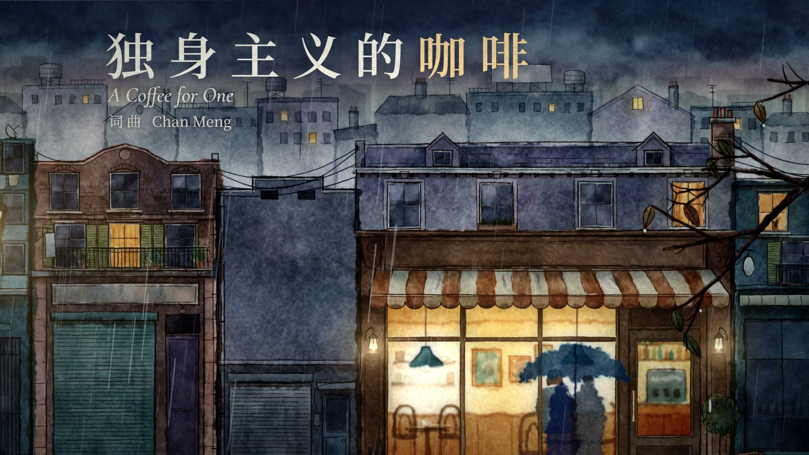

<div align="center">

# A Coffee for One · Music Video

**A four-minute music video drawn entirely in code: Python paints procedural watercolour layers, a web page animates them with rain on glass, headless Chrome renders every frame.**



</div>

## The film

### A Coffee for One · 独身主义的咖啡


https://github.com/user-attachments/assets/67f5c0f3-9a22-4ef9-a181-077cdb06d2b2


▶ Watch on YouTube: https://youtu.be/ZZGf4xiduVI

## How it's made

- **Paint.** `films/solo-coffee/paint/wc.py` is a small watercolour engine (numpy + OpenCV): subtractive washes, edge pooling, granulation, wet-in-wet bleed, pen lines with pressure and tremor. Each `s_*.py` paints one set and splits it by depth into WebP layers (68 in all).
- **Animate.** The page exposes `window.renderAt(t)`: a multi-plane parallax camera, lamps, rain, steam and self-drawing pen lines in Canvas 2D.
- **Glass and grade in WebGL2.** Water on the pane is a height field that refracts the scene; fog can be wiped clear by a mask; transitions behave like wet paint.
- **Cut to the lyric.** faster-whisper word times aligned to the lyric sheet by pinyin drive the edit list (`edit.js`); the lyric lights up character by character.
- No image or video generation model is used for the picture. Song by Chan Meng, made with Suno.

## Make your own

Needs Node 20+, Google Chrome and ffmpeg (Python 3.11+ with numpy, opencv-python and Pillow only to repaint). The song and the painted layers are in the repo. From a POSIX shell (Git Bash on Windows):

```sh
npm install
( cd films/solo-coffee/paint && python build.py )      # optional: repaint every layer
node harness/render.mjs films/solo-coffee --workers 3 --audio songs/solo-coffee.mp3 --crf 18
# → films/solo-coffee/out/video.mp4
```

## Licence

Code: MIT ([LICENSE](LICENSE)). The film, song, painted layers and other media made by Chan Meng: CC BY 4.0 ([LICENSE-MEDIA.md](LICENSE-MEDIA.md)). Excluded and under their own licences: the fonts (SIL OFL 1.1), the render harness adapted from [mg-styles-15](https://github.com/Vincentwei1021/mg-styles-15) (MIT) and the libraries, as listed in [films/solo-coffee/CREDITS](films/solo-coffee/CREDITS).

More detail: [docs/overview.md](docs/overview.md)
