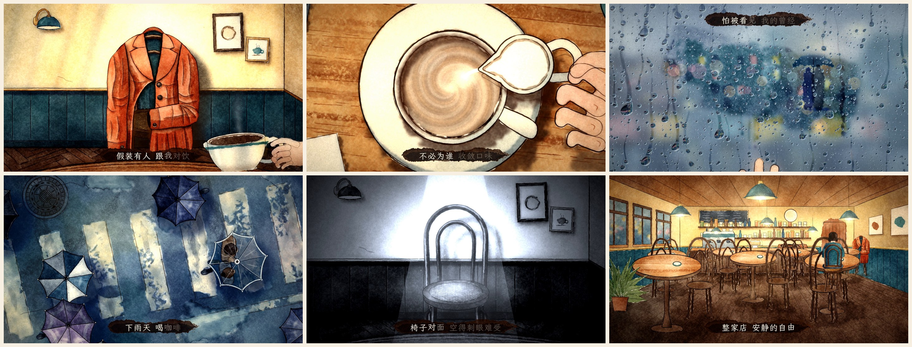
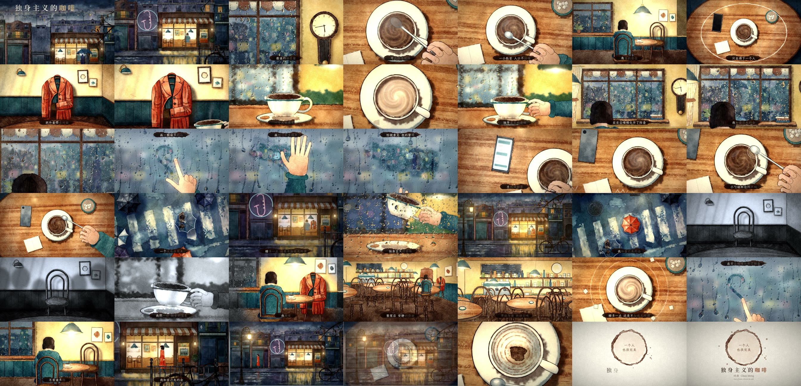

<div align="center">

# A Coffee for One · Music Video

**A four-minute music video drawn entirely by code. No image or video generation models, no footage, no SVG.**

Python paints the watercolours. A web page animates them as a pure function of time. Headless Chrome captures every frame and ffmpeg adds the song.


</div>

## About

This is the music video for **A Coffee for One** (《独身主义的咖啡》), written by Chan Meng and made with Suno: a laid-back 90s R&B and Mandopop song at about 87 BPM. The recording is the whole soundtrack and is not edited.

A rainy evening. One customer in a corner café. She drapes her coat over the chair opposite and pretends someone is drinking with her. She draws half a heart in the fog on the window and wipes it away. She turns her phone face down. She taps her spoon on the rim of the cup. When other people ask what she will do when she is old, the picture drains to grey, until she takes a sip and the colour spreads back out of the cup, across the corner, through the whole shop. At the end the rain stops, she finishes the heart, puts her coat on and walks off under the street lamps.



Three threads run through the film:

1. **The circle.** The rim of the cup, the saucer, the clock face, ripples, umbrellas, a record, every empty table, and last of all a coffee ring on paper. A circle is already complete. Each time the chorus reaches the word "perfect", a line of chalk goes once round the circles in the frame.
2. **Cool against warm.** Outside is Prussian blue and indigo rain. Inside is sienna wood and amber lamplight. One saturated colour, persimmon, belongs to her coat and to a single umbrella in the second chorus.
3. **No face.** She is only ever a back, a pair of hands, a reflection in the glass and, once, a profile hidden by her hair.

The whole film on one sheet, one frame every six seconds:



The finished MP4 is not in the tree: the master is about 680 MB, above GitHub's per-file limit. Render it with the commands below.

## How it is made

Three steps, the same three as painting backgrounds, shooting them and printing the film.

### 1. Paint (Python, `films/solo-coffee/paint/`)

`wc.py` is a small procedural watercolour engine built on numpy and OpenCV. A sheet stores absorbance per channel over a paper-white ground, so washes laid over each other mix subtractively, the way transparent pigment does. Each wash gets a wobbled outline, pigment pooled along its inside edge, granulation in the valleys of the paper tooth and slow backruns, with wet-in-wet bleed, dry brush and salt as options. Pen lines are stamped along a spline with pressure variation, a taper at both ends and a slight tremor. They overshoot corners and never quite close a shape.

`kit.py` holds the drawing habits shared by every painting: ruled-by-hand lines, colour that does not fill its outline, wood grain, a pen contour round a union of shapes, fingers. Each `s_*.py` describes in code how one set is painted, splits it by depth, and saves the layers as WebP: opaque for backgrounds, with alpha for foreground and anything that moves.

Nine sets, 68 layers, plus one sheet of paper texture shared by the whole film:

| Set | Module | What is in it |
|---|---|---|
| Street | `s_street.py` | A row of old buildings on a rainy night and the one lit café: sky, far roofs, façades, interior, wet road, street lamp, foreground bicycle and branch |
| Window | `s_window.py` | The big window from inside, its sill, the wall clock, the awning, a pendant lamp. The street outside is painted wet-in-wet, out of focus |
| Table | `s_table.py` | The round table from straight above: cup, saucer, spoon, sugar bowl, phone, a hand |
| Cup | `s_cup.py` | The cup at eye level, with the room behind it out of focus |
| Corner | `s_corner.py` | The corner seat, seen from behind her |
| Opposite chair | `s_chair.py` | The bentwood chair across the table, and the coat that sits on it |
| Whole shop | `s_shop.py` | The entire café in one-point perspective |
| Crossing | `s_umbrella.py` | A zebra crossing from straight above, and nine umbrellas |
| Figure | `s_figure.py`, `s_extra.py` | Her back (seated, and head and shoulders), a two-drawing walk in profile, several hands, a milk jug, the empty cup |

### 2. Animate (browser, `films/solo-coffee/*.js`)

The page exposes one function, `window.renderAt(t)`. Any frame is a pure function of `t`: no clock, no `Math.random`, nothing carried over from the previous frame. Frames can therefore be rendered out of order and in parallel.

- **`stage.js`**: a multi-plane parallax camera with zoom in log space, lamps, rain, ripples, steam, out-of-focus lights, chalk and pen lines that draw themselves.
- **`shots_*.js`**: 32 shots. A shot is a function that paints one frame into a 2D canvas and tells the post pass whether the frame is seen through glass and how to grade it.
- **`post.js`** (WebGL2):
  - **Glass.** Water on the pane is a height field. Beads sit and slowly swell. Runners slide down their own lanes in stick-slip steps and leave a wet track and a few small beads behind. The gradient of the height field refracts the scene, and where there is no water the scene is read from a blurred mip according to how much fog is on the glass. The line a finger draws in the fog, and the swathe a palm wipes clear, are a mask the fog gives way to.
  - **Transitions**, made to behave like wet paint: a stain spreading from a point, a loaded brush dragged across, a circle opening or closing (cup to clock, cup to umbrellas, cup to coffee ring), the old picture running down the sheet, and a plain dissolve. Pigment gathers darker at the wet front.
  - **Grade.** Saturation can spread outward from a point in the frame, which is how colour returns from the cup to the room in the bridge. On top of that: lamp bloom, vignette, the paper's tooth pressed into every frame, fine grain that changes every second frame, and a slight displacement eight times a second so the paintings never sit perfectly still.
- **`edit.js`**: the edit decision list. Shot boundaries come from the per-character lyric times and the beat grid. Only the instrumental passages, which have no lyric to hang on, use seconds written by hand.
- **`type.js`**: the lyric sits on a dry-brushed stroke of coffee and lights up character by character as it is sung.

### 3. Render (`harness/render.mjs`)

Three headless Chrome instances capture frames in parallel. ffmpeg encodes them and muxes the song.

## Timing

`tools/timing_all.sh` turns the recording into `films/solo-coffee/timing.json`:

- faster-whisper (large-v3) transcribes the vocal with word timestamps.
- `align.py` aligns the known lyric sheet to that transcript, matching by pinyin. All 45 sung lines aligned.
- `analyze.py` uses librosa for beats, onsets and loudness envelopes in four bands.

One line of the published lyric sheet is not in the film. The first line of the third chorus is not sung on the recording: the last line of the bridge takes its place. It was removed from `lyrics.txt` so the subtitles match what is heard.

## Storyboard

| Time | Section | Picture |
|---|---|---|
| 0:00 | Intro | The street in the rain, the title lettered into the sky. The camera comes down to the road and pushes in on the one lit window |
| 0:10 | Verse 1 | Rain on the window. Drops let go of the awning on the beat, and the second hand of the wall clock ticks on the beat |
| 0:20 | | The clock face opens, as a circle, onto the cup from above. She stirs slowly, one turn every two bars. One bitter drop falls back from the spoon |
| 0:31 | | The corner seat. Then the whole round table from above, laid for one, with chalk drawn once round it. Then the coat flies across the table and settles on the chair opposite |
| 0:43 | | Her point of view: the coat sits across from her. She raises her cup to it |
| 0:52 | Chorus 1 | The cup at eye level. The table from above, with chalk round every circle on it. A small jug comes in and the milk winds into a spiral. Four sugar cubes drop on four syllables, then fly back out one by one. She drinks, sets the cup down, and the picture runs down the sheet |
| 1:13 | | Couples pass outside the window. She raises her cup to her own reflection. The glass fogs over |
| 1:28 | Verse 2 | A finger draws half a heart and a smile in the fog, starts the other half and stops. A palm wipes it away. In the cleared strip, across the street, two people walk by under one umbrella. The fog closes again |
| 1:48 | | The phone is turned face down. The noise of the world becomes small zigzags that drift away by themselves |
| 1:58 | | Each tap of the spoon on the rim sends out a ring, each wider than the last |
| 2:09 | Chorus 2 | The rings open onto a street crossing from above. Umbrellas stream by in pairs. One persimmon umbrella takes its time straight across them |
| 2:17 | | The street at night, a neon saxophone, a car's headlights. The camera comes down to the reflection in the road. Then the cup seen through the wet window, the window's warmth spreading over the whole street, and the lone umbrella turning on the empty crossing like a record |
| 2:42 | Bridge | Grey. The chair opposite is empty. Shadows of people lean in on the wall, daylight sweeps past again and again, and then one hard light falls on the empty chair |
| 2:56 | | She takes a sip. Colour spreads out of the cup and across the corner |
| 3:07 | | "The whole shop": the camera pulls all the way back and six lamps come on in turn, on the beat |
| 3:12 | Chorus 3 | The lamps sway together, a record turns, chalk goes round every empty table. Sugar cubes orbit the cup. The last sip. This time she finishes the heart, and the whole pane clears from it outward |
| 3:31 | | The coat flies back to her and she gets up. The chair opposite is bare again, the same chair as in the bridge, and nothing about it hurts now. She sets her empty cup down |
| 3:36 | Outro | The rain has stopped. She walks off down the street with her umbrella furled, and the street lamp comes on |
| 3:51 | | The table after she has gone. A passing car's light crosses the empty cup. The rim of the cup closes into a coffee ring on paper, with the words "Alone is also complete" |

## Rebuild

Requirements:

- Python 3.11+ with numpy, opencv-python and Pillow. Timing also needs faster-whisper, librosa, pyloudnorm, soundfile, opencc and pypinyin.
- Node 20+, Google Chrome, ffmpeg.

From the repository root, in a POSIX shell (Git Bash on Windows):

```sh
npm install

# timing.json from the recording (the first run transcribes the song, a few minutes)
sh tools/timing_all.sh songs/solo-coffee.mp3

# paint every layer into films/solo-coffee/art/ (about 4 minutes)
( cd films/solo-coffee/paint && python build.py )

# look at a few frames (written to films/solo-coffee/out/stills/)
node harness/render.mjs films/solo-coffee --stills 12,48.6,190.5

# a contact sheet
python tools/sheet.py films/solo-coffee 6 5,20,35,50,65,80 sheet-test.jpg

# a passage, to judge motion
node harness/render.mjs films/solo-coffee --from 128 --to 134 --workers 3 \
  --out films/solo-coffee/out/clip.mp4 --audio songs/solo-coffee.mp3

# the film (films/solo-coffee/out/video.mp4)
node harness/render.mjs films/solo-coffee --workers 3 --audio songs/solo-coffee.mp3 \
  --crf 18 --tune grain --threads 12
```

To repaint one set, name its jobs: `python build.py corner_bg corner_table`. The job names are the keys of `ALL` at the end of each `s_*.py`. With `WC_VIEW=<dir>` set, `--view=layer,layer@x:y,...` also writes a flattened preview of the named layers.

To scrub through the film in a browser, run `python -m http.server 8000` in the repository root and open `http://localhost:8000/harness/preview.html?demo=solo-coffee`. To look at one shot alone, open the film page with `?shot=<id>`, using an id from `edit.js`.

## Layout

```
songs/                    the recording
tools/                    timing (transcribe, align, analyse) and contact sheets
harness/                  frame-by-frame renderer and a preview page
lib/                      timing helpers, easing, deterministic noise, font table
assets/fonts/             fonts (SIL OFL)
films/solo-coffee/
  lyrics.txt  timing.json
  paint/                  the watercolour engine and how each set is painted (Python)
  art/                    the painted layers (WebP) and manifest.json
  index.html  film.js  edit.js  core.js  stage.js  post.js  type.js  shots_*.js
  poster.jpg  frames.jpg  sheet.jpg
  CREDITS
```

## Credits

Song and lyrics by Chan Meng, made with Suno. Picture drawn in code with [Claude Code](https://claude.com/claude-code).

Sources, adapted ideas, fonts and libraries are listed in [`films/solo-coffee/CREDITS`](../films/solo-coffee/CREDITS).
